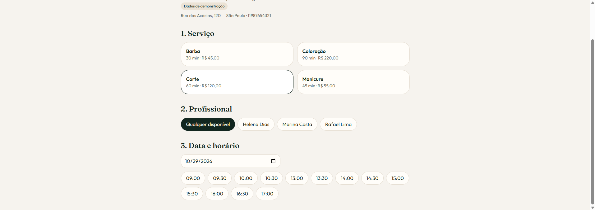
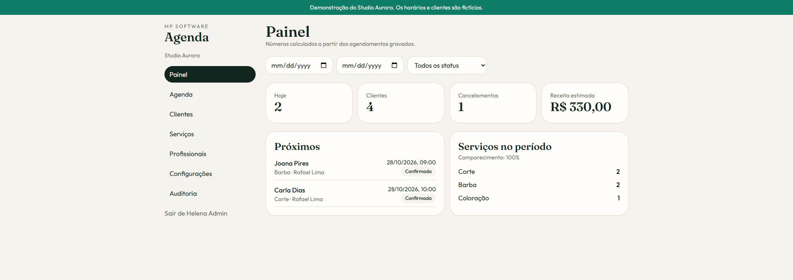
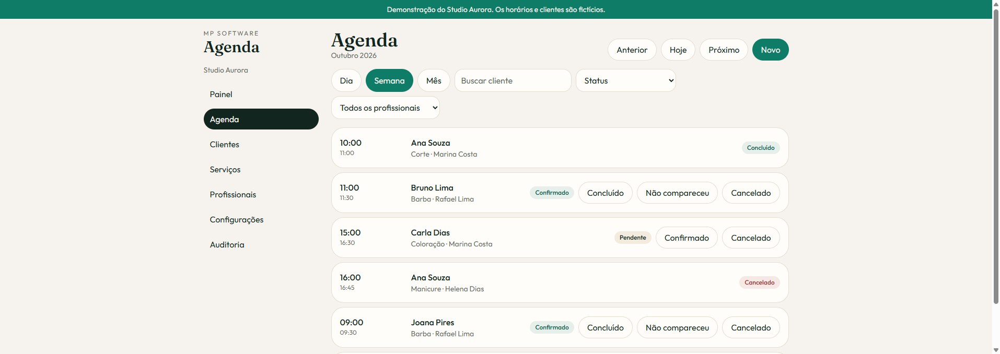

# MP Agenda

Agendamento online para salões, barbearias, clínicas e profissionais autônomos. O cliente escolhe um horário que existe de verdade; o negócio acompanha a agenda, os clientes e a receita estimada.

[](https://github.com/MatheusPereira64/PWA-AGENDAMENTO/actions/workflows/ci.yml)

## Telas

A demonstração local é o Studio Aurora. As imagens abaixo foram feitas nesse ambiente.

| Página inicial | Agendamento público |
| --- | --- |
|  |  |

| Painel | Agenda |
| --- | --- |
|  |  |

- Demo: `PREENCHER_COM_URL_REAL_DA_VERCEL`
- API: `PREENCHER_COM_URL_REAL_DO_RENDER`
- Swagger: `PREENCHER_COM_URL_REAL_DA_API/docs`

Os três endereços acima são placeholders. Este ambiente não publicou a Vercel nem o Render; não trate esses textos como URLs de produção.

## Funcionalidades

- Landing e página pública por slug (`/b/studio-aurora`)
- Cadastro do negócio, login, sessão com refresh token em cookie HttpOnly e papéis de administrador, profissional e cliente
- Agenda diária, semanal e mensal, com filtros e mudança de status
- Disponibilidade calculada no servidor: expediente, intervalo, folga, antecedência e duração
- Proteção contra dois agendamentos no mesmo horário, inclusive em requisições simultâneas
- Clientes, serviços, profissionais, configurações de marca e indicadores calculados no banco
- Exportação CSV, auditoria administrativa e preparação de planos, sem gateway de pagamento
- PWA instalável, com cache do aplicativo e aviso claro quando uma ação precisa da internet

## Tecnologias

React, TypeScript, Vite, Tailwind CSS, shadcn/ui (Radix), React Router, TanStack Query, React Hook Form, Zod, Express, Prisma, PostgreSQL, JWT, Argon2, Vitest e `vite-plugin-pwa`.

## Arquitetura

O monorepo separa o app (`apps/web`), a API (`apps/api`) e os contratos compartilhados (`packages/shared`). A API revalida todas as regras. Horários recorrentes ficam em `HH:mm` no fuso do negócio; agendamentos e bloqueios ficam em `timestamptz` UTC.

A criação do agendamento trava o profissional e grava dentro de uma transação. A constraint `appointment_no_overlap` impede sobreposição mesmo se duas requisições passarem juntas. As regras estão em [docs/regras-de-negocio.md](docs/regras-de-negocio.md).

## Modelo

`Plan`, `Business`, `User`, `BusinessMembership`, `Customer`, `Professional`, `Service`, `ProfessionalService`, `BusinessWorkingHours`, `ProfessionalWorkingHours`, `TimeOff`, `Appointment`, `RefreshToken`, `PasswordResetToken`, `AppointmentAccessToken`, `AuditLog`.

## Instalação local

Requisitos: Node.js 22. Não é necessário instalar PostgreSQL: `npm run db:prepare` sobe um Postgres embarcado na porta 5433.

```bash
npm install
npm run db:prepare
npm run db:seed
npm run dev
```

- App: http://localhost:5173
- API: http://localhost:3333
- Swagger: http://localhost:3333/docs

O frontend em desenvolvimento encaminha `/api` para a API, então o cookie de sessão fica no mesmo site.

### Variáveis

O arquivo [`.env.example`](.env.example) lista as variáveis. `npm run db:prepare` cria `apps/api/.env` e `apps/api/.env.test` se eles ainda não existirem. Segredos reais não entram no repositório.

| Variável | Uso |
| --- | --- |
| `DATABASE_URL` | Postgres da API |
| `JWT_ACCESS_SECRET` | Assinatura do token de acesso (mínimo 16 caracteres) |
| `CORS_ORIGIN` | Origem do frontend. Várias origens separadas por vírgula |
| `APP_URL` | Link de redefinição de senha |
| `COOKIE_SECURE` | `true` em produção, com `SameSite=None` |
| `VITE_API_URL` | URL absoluta da API no build da Vercel. Vazio usa o proxy local |
| `SMTP_HOST`, `SMTP_PORT`, `SMTP_USER`, `SMTP_PASS`, `SMTP_FROM` | E-mail real. Sem isso, a recuperação de senha responde 503 |
| `GOOGLE_CLIENT_ID`, `GOOGLE_CLIENT_SECRET`, `GOOGLE_REDIRECT_URI` | Só indicam que a integração pode ser ligada. Nenhum evento é criado |
| `CRON_SECRET` | Protege `POST /api/jobs/reminders` |

### Comandos

```bash
npm run dev
npm run build
npm run lint
npm run typecheck
npm test
npm run db:migrate
npm run db:seed
```

`npm test` sobe o Postgres local se `DATABASE_URL` não vier do ambiente e aplica as migrations no banco `mpagenda_test`.

## Demonstração

O seed cria o **Studio Aurora** (`studio-aurora`), marcado como demonstração.

| Perfil | E-mail | Senha |
| --- | --- | --- |
| Administrador | admin@studioaurora.example.com | Aurora#2026 |
| Profissional | marina@studioaurora.example.com | Marina#2026 |
| Cliente | cliente@studioaurora.example.com | Cliente#2026 |

Troque essas senhas fora de uma demonstração local. Os e-mails usam `example.com` e não recebem mensagens.

## API

A especificação interativa fica em `/docs`. Rotas autenticadas usam `Authorization: Bearer` e, se a pessoa participa de mais de um negócio, `X-Business-Id`. A página pública só usa o slug e não devolve contatos de outros clientes.

## Deploy

O arquivo [`vercel.json`](vercel.json) gera o frontend e devolve `index.html` para o React Router. Na Vercel, defina `VITE_API_URL` com a URL pública da API.

O [`render.yaml`](render.yaml) descreve a API e o Postgres. `prisma migrate deploy` roda antes do novo release. Defina `CORS_ORIGIN` com o domínio da Vercel e `APP_URL` com o mesmo endereço. `JWT_ACCESS_SECRET` é gerado pelo Render e não deve ser commitado.

Esta cópia não foi publicada. Enquanto a publicação não for verificada, mantenha os placeholders do topo.

## Limitações

- Recuperação de senha e lembretes exigem SMTP. Sem as variáveis, a API informa que o e-mail não está configurado e não simula envio.
- Google Calendar não sincroniza eventos. O endpoint só mostra se as credenciais existem.
- Não há cobrança. O modelo `Plan` limita profissionais e agendamentos mensais.
- O aplicativo instalado abre offline e guarda os arquivos estáticos. Agendamentos não entram em fila local: a vaga pode mudar enquanto o aparelho está desconectado.
- Tokens de acesso ficam só na memória. O refresh token fica em cookie HttpOnly e não entra no cache do service worker.

## Próximos passos

Lembrete por e-mail com SMTP real, sincronização opcional com Google Calendar, cobrança recorrente e publicação verificada na Vercel e no Render.
